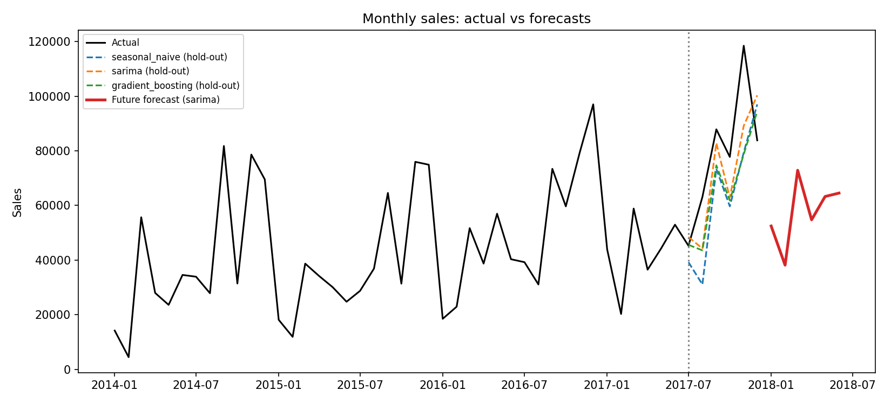
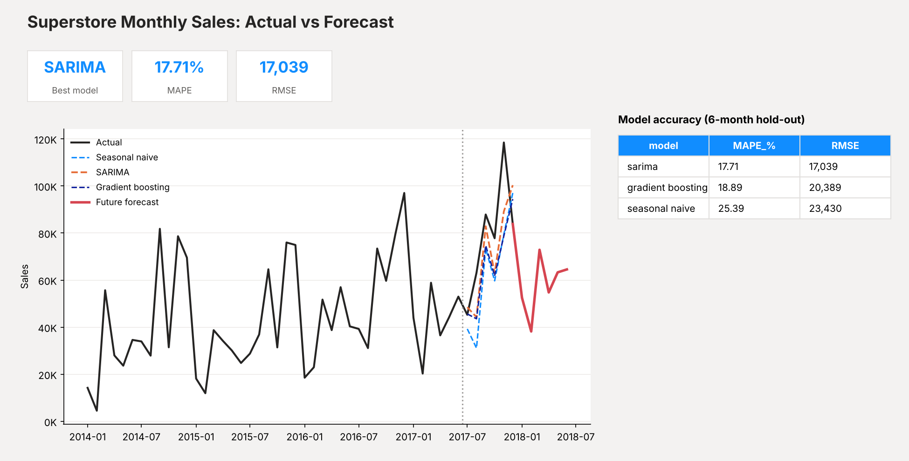

# Superstore Sales Forecasting

Forecasts monthly sales for the Global Superstore dataset. The pipeline checks and cleans the data, aggregates it with SQL,
compares a baseline against statistical and machine-learning models using **MAPE and RMSE**, and exports results for a **Power BI** forecast chart.

**Stack:** Python, pandas, scikit-learn, statsmodels (SARIMA), SQL (SQLite), Power BI, pytest

## Pipeline
1. **Data quality** (`src/data_quality.py`): checks missing values, duplicate rows, unparseable dates, non-numeric and non-positive sales, future dates, and sales outliers. Writes `outputs/data_quality_report.md/.json` with before/after counts.
2. **SQL** (`src/sql_layer.py`): loads clean orders into SQLite and aggregates monthly sales with a `GROUP BY` query.
3. **Models** (`src/forecasting.py`), all evaluated on the same hold-out (last 6 months):
   - Seasonal naive baseline (same month last year)
   - SARIMA, with orders selected by AIC from a small grid
   - Gradient boosting (scikit-learn) on lag and calendar features, forecasting recursively
4. **Evaluation:** MAPE and RMSE per model in `outputs/metrics.csv`; best model chosen by RMSE.
5. **Forecast:** the best model is refit on all history and forecasts the next 6 months.
6. **Outputs:** `forecast_results.csv` (for Power BI), `forecast_chart.png`, `model_details.json`.

## Run it
```bash
pip install -r requirements.txt
# the dataset is already in data/superstore.csv, then:
python run_pipeline.py --data data/superstore.csv
python -m pytest            # 5 tests: metrics, baseline, cleaning, end-to-end
```
Options: `--horizon 6` (months held out and forecast), `--out outputs`.

## Results
Dataset: Superstore sales, 9,994 order lines, Jan 2014 to Dec 2017 (48 months), aggregated to monthly sales. Hold-out = last 6 months (Jul to Dec 2017).

| Model | MAPE (%) | RMSE |
|---|---|---|
| Seasonal naive (baseline) | 25.39 | 23,430 |
| **SARIMA (0,1,1)(0,1,1,12)** | **17.71** | **17,039** |
| Gradient boosting | 18.89 | 20,389 |

SARIMA beat the baseline by about 7.7 percentage points of MAPE (about 27% lower RMSE). Gradient boosting also beat the baseline but not SARIMA, which is plausible with only 42 training months.

**Data quality findings:** 9,994 rows, no missing values, 1 exact duplicate order line removed (after ignoring the Row ID counter), no invalid dates or non-positive sales, 668 high-value order lines flagged as outliers (IQR rule) and kept because they are real sales. See `outputs/data_quality_report.md`.



## Power BI chart
A ready-to-load kit (data, DAX measures, setup steps, preview image) is in `powerbi/`; start with `powerbi/SETUP.md`. The manual steps are below.

1. Power BI Desktop -> **Get data -> Text/CSV** -> `outputs/forecast_results.csv`.
2. Insert a **Line chart**: X-axis = `month` (use the date field, not the hierarchy), Y-axis = `actual`, `seasonal_naive`, `sarima`, `gradient_boosting`, `future_forecast`.
3. Add a card for the best model and a table visual from `outputs/metrics.csv`.
4. Target layout (`powerbi/powerbi_preview.png`):



## Data source
`data/superstore.csv` is the widely used Superstore sample dataset (also on Kaggle as "Superstore Dataset"). It is a fictional retail dataset, not real company data.

## Limitations
Only four years of monthly data and a 6-month hold-out, so metrics are noisy and a ~17% MAPE is moderate, not excellent. Monthly sales are volatile (large single orders). Forecasts are for total sales; segment-level (category/region) forecasts and prediction intervals are natural next steps.
